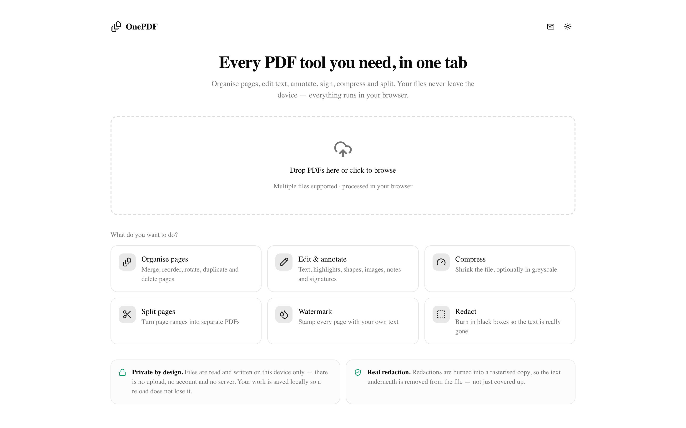
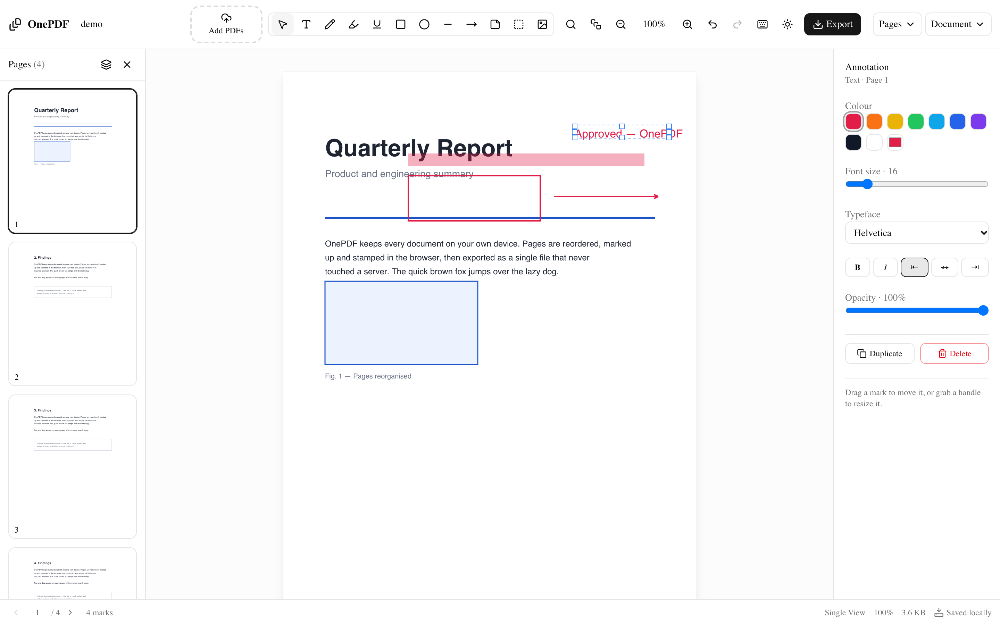
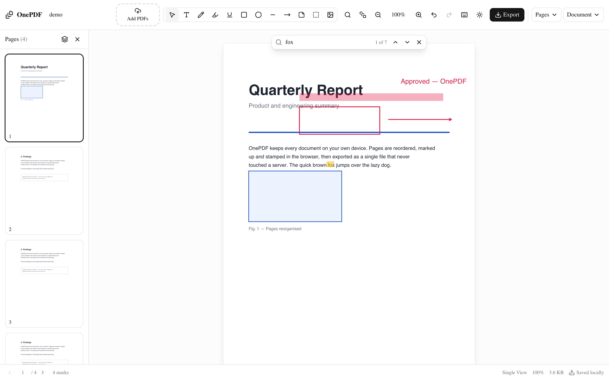
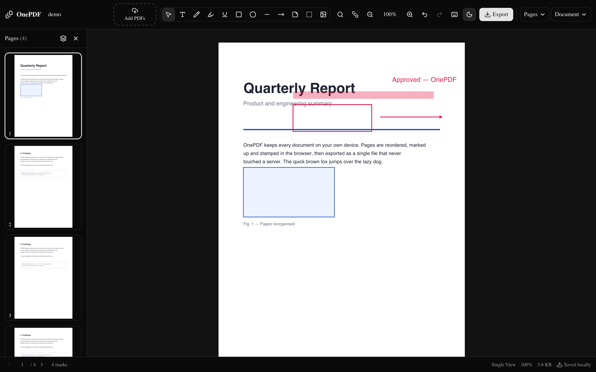
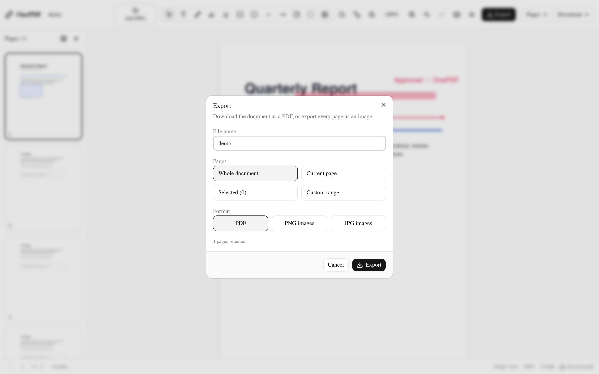

# OnePDF

A modern, fully client-side PDF manager. Organise, merge, edit, annotate, sign,
compress, split and export PDFs entirely in your browser — no files ever leave
your machine.

[](https://onepdf-three.vercel.app)
[](https://vercel.com/new/clone?repository-url=https://github.com/zarifRahman/OnePDF)
[](https://github.com/zarifRahman/OnePDF)

**Try it live → https://onepdf-three.vercel.app** · **Source code → https://github.com/zarifRahman/OnePDF**

> **Status:** v2 — task-first onboarding, page management (including an
> explicit merge and image-as-page insert), a full annotation editor, document
> tools (watermark / compress / redact / split / remove images), in-document
> search and local autosave. All client-side.

## Screenshots

**Task-first home screen** — pick what you want to do, drop a PDF in, and the
app opens straight into that tool.



**Editor** — tool rail, page rail, live annotation overlay, contextual
properties panel, status bar.



**Search inside the document** — every match is highlighted, with next/previous
navigation.



**Dark mode** — the whole shell follows the theme.



**Export** — whole document, current page, selection or a custom range, as PDF
or as PNG/JPG images.



**Continuous view** — scroll through the whole document, or switch to facing
pages.


## Features

**Start**
- **Task-first home screen** — pick what you want to do (organise, merge,
  edit, compress, split, watermark, redact) and drop a PDF in; the app opens
  straight into that tool
- **Drag-and-drop or file picker**, multiple files at once
- **Recent documents** — the last session is restored automatically, everything
  is kept in IndexedDB on your device
- **Privacy stated up front** — no upload, no account, no server

**Organise pages**
- **Multi-select** (click, ⇧-click for a range, ⌘-click to toggle) with a
  batch bar: rotate, duplicate, export selection, delete
- **Merge** any number of PDFs into one, **reorder** by drag-and-drop — either
  from the home screen or with **Pages ▸ Merge with another PDF…**
- **Insert image as page** — a PNG or JPEG becomes a page of its own
- **Rotate**, **duplicate**, **delete**, **insert blank pages**
- **Split** page ranges into separate PDFs (downloaded as one ZIP)
- **Crop margins** off a page (Acrobat-style trim)
- **Page numbers** with position, format (`1`, `1 / 10`, `Page 1 of 10`) and
  start value
- **Watermark** — text, size, colour, opacity and angle across every page

**Edit / annotate**
- **Text** anywhere, plus **edit existing text** in the PDF (click a line)
- **Freehand draw**, **highlight**, **underline**, **line**, **arrow**
- **Shapes** (rectangle, circle) with stroke *and* fill
- **Images** (insert a PNG/JPEG, or draw a signature and drop it on the page),
  **sticky notes**
- **Redaction** — black boxes that are burned into the file, so the text
  underneath is really gone
- **Remove images** from a page — the image objects are cut out of the page
  and dropped from the file, so the pixels are gone while the text and the
  vector artwork stay sharp
- **Move and resize** any mark with grab handles
- **Font family, size, bold/italic, alignment, opacity, colour**

**View & find**
- **Single page**, **continuous scroll** and **facing pages** views
- **Fit width / fit page / zoom**, pan by dragging
- **Search the document** (`⌘F`) with highlighted matches and next/previous
- **Status bar** with page, selection, mark count, file size and save state

**Output**
- **Export** the whole document, the current page, the selection or a range
- **Export pages as PNG/JPG** (one ZIP)
- **Compress** the document in the browser, optionally in greyscale, and see
  the size saved before you download

**Everywhere**
- **Undo / redo** for every edit, with the action named ("Undid: Rotate page")
- **One click home** — the OnePDF logo in the header saves your work and takes
  you back to the home screen, where the document waits under *Recent
  documents*
- **Light / dark** mode
- **Keyboard shortcuts** for every tool (`?` shows the list)
- 100% in-browser — nothing is uploaded to any server

## Getting started

- **Live demo** → https://onepdf-three.vercel.app (deployed from this repo with
  Vercel — every tool runs in your browser, so the deployment only serves the
  static app)
- **Source code** → https://github.com/zarifRahman/OnePDF

Prerequisites: **Node 20.9+** and **pnpm** (npm also works).

```bash
pnpm install
pnpm dev
```

Open http://localhost:3000.

With npm instead:

```bash
npm install
npm run dev
```

### Scripts

| Command | What it does |
| --- | --- |
| `pnpm dev` | Start the dev server |
| `pnpm build` | Production build |
| `pnpm start` | Serve the production build |
| `pnpm test` | Run the unit tests (Vitest) |
| `pnpm lint` | Lint |

> `postinstall` copies the pdf.js worker into `public/` so it is served
> locally (offline, no CDN).

### Deploy

There is no server, no API and no database — Next.js prerenders the single
route at build time, so the deployment is just the static app.

```bash
npm i -g vercel
vercel --prod          # from the repo root
```

Or click the **Deploy with Vercel** badge at the top to fork and deploy. The
live deployment is at https://onepdf-three.vercel.app.

Two things to know about the deployment:

- `postinstall` must run so `public/pdf.worker.min.mjs` exists; Vercel runs it
  automatically with `pnpm install`.
- The app is fully client-side, but PDF work is CPU-bound: very large
  documents can still take a moment to re-serialise in the browser. The
  Node.js runtime is the right one (the pdf.js worker and pdf-lib both need it).

## Architecture

The one decision everything else follows: **render and edit are separate.**

- **pdf.js (via `react-pdf`)** renders pages/thumbnails to canvas. Read-only —
  it never mutates a document.
- **pdf-lib** owns the document model and every mutation. Source of truth.

State is a lightweight **page-descriptor model** (Zustand): an ordered array of
`{ id, fileId, sourceIndex, rotation, isBlank, crop }`. Edits mutate this
metadata, not PDF bytes — so reorder/rotate/delete and undo/redo are cheap
(undo just snapshots the array). Bytes are only re-serialized for the preview
and for download. **Merge falls out for free**: descriptors simply span
multiple source files.

```
uploaded bytes → pdf-lib docs [truth]
              → page-descriptor model (ordered metadata, in Zustand)
              → exportPdf() serializes to bytes
              → react-pdf renders bytes for viewer + thumbnails
```

**Removing images** is the one edit that rewrites bytes instead of metadata.
The page's content stream is scanned for the operators that paint images
(`/Name Do` for an image XObject, `BI … ID … EI` for an inline one) while the
graphics state is tracked to find where each image sits, and those operators
are cut out of the stream. The image objects are then dropped from the page's
resources and deleted from the file when nothing else points at them — so the
pixels are gone rather than covered up, and the text layer and the vector
artwork survive untouched.

One `react-pdf <Document>` is mounted for the whole app, so the sidebar
thumbnails and the viewer share a single copy of the bytes and a single pdf.js
instance.

### Project layout

```
app/                 App Router: layout (theme + toaster), page (loads Workspace)
components/
  Workspace.tsx      client-only shell (react-pdf loaded with ssr:false)
  app/               welcome screen, status bar, search bar, shortcuts dialog
  upload/            drag-drop dropzone
  sidebar/           sortable thumbnail list, batch bar
  viewer/            page views: single / continuous / facing
  editor/            annotation overlay, properties panel, signature pad
  dialogs/           split, watermark, compress, export, margins, page numbers,
                     remove images
  ui/                shadcn/ui primitives
lib/
  pdf/               exportPdf, rasterise (compress/redact/images), search,
                     text extraction, page ranges, zip writer, content-stream
                     scanner, image removal, image-to-page
  db/                IndexedDB persistence (autosave + recents)
  hooks/             keyboard shortcuts, autosave/restore
  utils.ts           cn(), uuid, downloadBytes, formatBytes
store/               zustand document store (+ undo/redo with action labels)
types/               PageDescriptor, SourceFile, Annotation, document settings
```

### Notes

- The whole workspace is loaded with `next/dynamic({ ssr: false })` because
  pdf.js touches browser-only globals (`DOMMatrix`) at module evaluation.
- Thumbnails and viewer pages render **lazily** (IntersectionObserver).
- The viewer renders pages from a *pages-only* export, while annotations are
  drawn live as an SVG overlay. Anything that produces a real file (export,
  compress, rasterise) uses `buildDocumentBytes()`, which bakes the marks in —
  so nothing is silently dropped.

### Annotation model

Annotations are a second descriptor array in the store (`Annotation[]`), keyed
by page id, with geometry in **PDF points, top-left origin**. They render live
as an **SVG overlay** on the current page (`viewBox` in points, so it scales
with zoom for free) and are **baked into the PDF only on download** via pdf-lib
(`drawText`/`drawLine`/`drawRectangle`/`drawEllipse`/`drawImage`, y-flipped to
pdf-lib's bottom-left origin) — the preview stays pages-only, so no double-draw.
Undo/redo snapshots pages + annotations + page numbers + watermark together.

### Raster pipeline

`lib/pdf/raster.ts` renders pages to bitmaps with pdf.js and rebuilds the PDF
from those bitmaps. It powers Compress, greyscale, secure redaction and image
export. A rasterised page has no text layer, which is what makes redaction
genuine rather than cosmetic.

Known simplifications (`ponytail:` in code):
- Highlight/underline are drawn boxes/lines, not bound to the text layer.
- Annotations assume the page is at rotation 0.
- Redaction is applied to the rasterised copy; the in-editor view shows the box.

## Competitive analysis

`docs/research/competitive-ux-analysis.md` records the REA evidence (capture
ids included) behind this feature set and the reasoning behind each decision.

## Testing

- Unit-test `lib/pdf/exportPdf` with assert-based checks: reorder produces
  expected page order; rotation is applied; blank page count correct; merge of
  two 1-page docs yields a 2-page doc; annotations, watermarks and crop boxes
  are really present in the output.
- Store reducer tests: undo/redo restores prior `pages` array, multi-select
  ranges, duplication, crop, history labels.
- Page-range and ZIP writer tests.
- Runnable via `vitest` (`pnpm test`).
